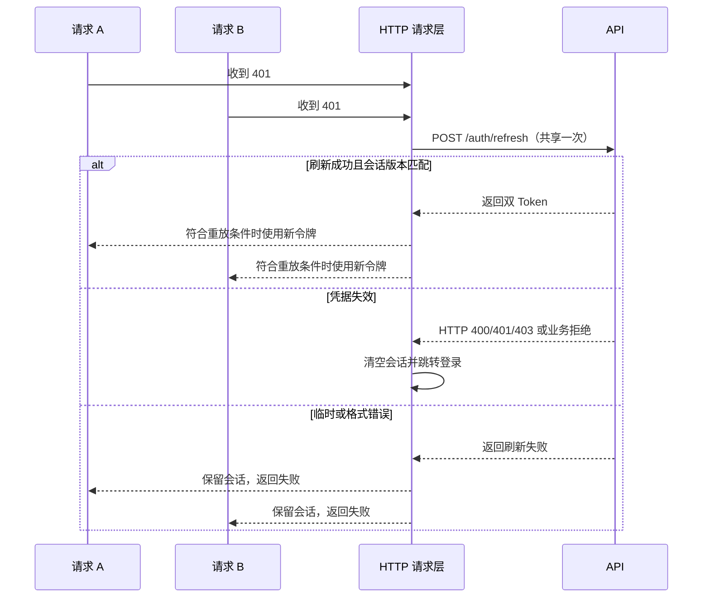

# Axios HTTP 请求层技术设计文档

> 项目：workbase-admin-fornt（企业级管理后台脚手架）
> 编写日期：2026-11-12

## 1. 背景与目标

业务请求通过 `@/utils/http` 使用共享 Axios 实例。TanStack Query 负责服务端缓存和查询重试，HTTP 层负责请求配置、认证、响应解析、错误处理和取消。

| 功能              | 约定                                                  |
| ----------------- | ----------------------------------------------------- |
| 统一 baseURL 管理 | 按 Vite mode 配置，开发默认走 `/api` 代理             |
| Token 注入 / 刷新 | 持久化双 Token，并发 401 共享一次刷新，按请求类型重放 |
| 响应体解析        | 默认提取 `data`，支持自定义字段、解析器和完整响应     |
| 错误归一化        | 区分业务错误、响应格式错误、Axios 传输错误和取消      |
| 通知提示          | 在 React 树外调用 antd 的 error、warning 和 success   |
| 路由切换取消请求  | TanStack Router 路径变化时取消当前路由拥有的请求      |
| 重复请求处理      | 相同的进行中请求取消前者，保留最新                    |
| 文件上传          | multipart/form-data、进度回调和取消                   |
| 文件下载          | Blob、Content-Disposition 文件名和对象 URL 清理       |

TypeScript 保持项目的严格选项。请求边界使用类型收窄和 `import type`。异常为 `Error` 或其子类，Promise 由调用方等待、返回或显式处理失败。

## 2. 模块职责

| 模块                                                                                               | 职责                                             |
| -------------------------------------------------------------------------------------------------- | ------------------------------------------------ |
| [公共入口](../src/utils/http/index.ts)                                                             | 请求方法、文件助手、解析配置、错误类型和通知函数 |
| [请求层](../src/utils/http/instance.ts)                                                            | Axios 实例、目标地址校验、去重键、认证和重放     |
| [响应解析](../src/utils/http/response-parser.ts)                                                   | 响应字段、默认解析器和业务码校验                 |
| [错误类型](../src/utils/http/error.ts)                                                             | `ApiError`、`ApiResponseError` 和错误信息        |
| [取消管理](../src/utils/http/cancel.ts)                                                            | 调用方取消、同键请求替换和路由级取消             |
| [会话与刷新](../src/stores/auth.ts)、[刷新协调](../src/utils/http/refresh.ts)                      | 持久化双 Token、隔离会话、合并并发刷新           |
| [通知桥接](../src/utils/http/notify.ts)、[应用 Provider](../src/providers/AppProviders.tsx)        | 复用 antd App 上下文                             |
| [上传](../src/utils/http/helpers/upload.ts)、[下载](../src/utils/http/helpers/download.ts)         | 文件请求和浏览器交互                             |
| [应用入口](../src/main.tsx)、[路由](../src/router/index.ts)、[QueryClient](../src/query-client.ts) | 会话失效导航、路由取消、缓存和重试               |

## 3. 环境配置

`.env.development`、`.env.test`、`.env.staging` 和 `.env.production` 均配置 `VITE_API_BASE_URL=/api`。空值或未定义时同样使用 `/api`。变量类型在 [src/vite-env.d.ts](../src/vite-env.d.ts) 声明。

- Vite 开发服务器的 `/api` 代理由 [vite.config.ts](../vite.config.ts) 配置。应用部署前缀 `/workbase/` 与 API 前缀 `/api` 各自独立。
- 部署时使用同源 `/api`，由部署环境配置 API 转发。环境使用独立 API 地址时，在对应 mode 的构建环境注入 `VITE_API_BASE_URL`。该变量进入前端产物。
- 请求使用 `/users` 这样的 API 相对路径。以单个 `/` 开头，拒绝绝对 URL、协议相对 URL、反斜杠、空白以及明文或编码的 `.`、`..` 路径段。请求默认超时 15 秒。

## 4. HTTP API

### 4.1 响应解析与错误

`http.get<T>`、`http.post<T>` 和 `http.request<T>` 默认返回响应体的 `data`。默认成功码为 `0`。响应可以省略 `code` 和 `message`，`data` 可以为 `null`。存在 `code` 时要求它为有限数字。非成功码抛出 `ApiError`，含 `code`、`message` 和 `httpStatus`。缺少数据或字段格式不合法时抛出 `ApiResponseError`。

- 应用初始化时可以使用 `configureResponse({ dataField, codeField, messageField, successCode })` 覆盖默认字段和成功码。
- 使用 `setResponseParser` 替换默认解析器。单个接口可为 `http.request` 传入同步或异步解析函数。解析函数可在返回业务数据前校验运行时结构。
- 使用 `http.requestRaw<T>` 获取 Axios 完整响应，适用于读取状态码、响应头、处理 `204` 空响应或直接获取 Blob。该入口保留 Axios 的 HTTP 状态处理，并跳过默认业务解析。
- `isApiError` 用于业务错误类型收窄。普通 `Error` 和 Axios 错误保持原类型，其他抛出值包装为带 `cause` 的 `Error`。请求取消保留 Axios 的取消类型。

```typescript
import { http } from '@/utils/http';

interface User {
  id: string;
  name: string;
}

export function getUser(userId: string) {
  return http.get<User>(`/users/${encodeURIComponent(userId)}`);
}

export async function removeUser(userId: string) {
  const response = await http.requestRaw({
    url: `/users/${encodeURIComponent(userId)}`,
    method: 'delete',
  });
  return response.status;
}
```

### 4.2 通知

`AppProviders` 使用 `App.useApp()` 注册 antd 实例，应用代码可从 `@/utils/http` 调用 `notifyHttpError(message)`、`notifyHttpWarning(message)` 和 `notifyHttpSuccess(message)`。

独立请求默认提示错误。传入 `silent: true` 后由调用方展示。取消、403 和已处理的会话失效跳过错误提示。由 TanStack Query 发起的请求使用下文的静默选项，将错误提示交给最终失败的回调。

### 4.3 双 Token 与会话失效

登录使用 `POST /auth/login`，请求体包含 `username`、`password`。刷新使用 `POST /auth/refresh`，请求体包含 `refreshToken`。两者成功响应的业务数据包含非空的 `accessToken` 和 `refreshToken`。活动会话标识保存在 `localStorage` 的 `workbase-auth-session`，令牌按会话写入 `workbase-auth:<sessionId>`。旧版 `workbase-auth` 中的令牌仍可读取。

- 默认注入 `Authorization: Bearer <accessToken>`。公开接口使用 `skipAuth: true`。仅跳过自动刷新时使用 `skipRefresh: true`。配置 `auth` 时使用 Axios Basic Auth。
- 同一标签页内，同一会话的并发 401 共享一次刷新。支持 Web Locks 时，同一会话跨标签页串行刷新。使用共享存储的兼容路径会在刷新被拒绝时，先等待仍在进行的同会话刷新，再判断是否结束会话。其他请求已经更新令牌时，后续 401 可直接使用新令牌。
- 刷新完成后，读请求最多重放一次。写请求仅在显式设置 `replayOnUnauthorized: true` 时重放。重放使用首次发送前保存的参数、请求体和请求头。默认转换下的原生 HTML 表单在首次发送前保存为 FormData。原生表单使用自定义请求转换时保留初次派发的原生表单参数，并跳过自动重放。流式请求和依赖外部状态的自定义转换需要由调用方保证可重放。
- 缺少刷新令牌，或者刷新接口以 HTTP 400、401、403 或业务错误 `ApiError` 拒绝凭据时，清空会话和 Query 缓存，由应用路由跳转到 `/login`，部署路径为 `/workbase/login`。
- 断网、超时、5xx 或刷新响应格式错误保留会话，并返回失败给调用方。各标签页同步活动会话变化。退出或重新登录后，旧请求的结果和刷新响应随之失效，迟到的刷新只允许更新或清理其所属会话。

### 4.4 去重和路由取消

进行中的等价请求取消前者。去重键包含 HTTP 方法、归一化 URL 和查询参数、请求头、凭据选项、响应类型、会话版本和可序列化请求体。URL 校验、去重和派发使用进入请求层时固定的地址。JSON 对象字段顺序和普通查询参数顺序不影响比较，数组元素顺序保留。请求头的禁用标记，以及省略请求体和显式 JSON `null` 各自比较。Basic Auth、自定义序列化、FormData 和含二进制字段的请求不参与默认去重。可通过 `skipDedupe: true` 由调用方管理并发。

客户端取消可能发生在写请求已经发出之后。提交按钮使用 Mutation 的 `isPending` 防止重复操作，需要重放的写接口应满足对应的幂等约定。

- 独立的 `GET`、`HEAD`、`OPTIONS` 请求默认随路由路径变化取消。同路径重新加载、搜索参数或 hash 变化保留请求。
- 独立写请求可以使用 `routeScoped: true` 加入路由取消。使用 `skipRouteCancel: true` 保留跨页面请求。
- 传入 `signal` 时由调用方管理请求生命周期。例如 Query 向服务函数传递自身的 signal，路由 loader 可以传递自身的 signal。取消会及时结束异步响应解析的等待。

### 4.5 文件上传和下载

`uploadFile<T>` 接收 `File` 或 `Blob`，通过 FormData 发送。默认文件字段名为 `file`，可用 `fieldName` 和 `extraFields` 配置表单。浏览器设置 multipart 边界。助手转发 `onProgress` 与 `signal`，并接受 `silent` 和 `routeScoped`。

`downloadFile` 支持 GET 或 POST，接收 `params`、`data`、`signal` 和 `silent`。文件名依次使用显式 `filename`、`Content-Disposition` 的 UTF-8 `filename*`、普通 `filename`、默认值 `download`。下载完成后清理对象 URL，且下载请求跨路由保留。下载响应是未声明为文件的 JSON 时，助手识别其中的业务错误。HTTP 失败返回 JSON Blob 时，错误提示可使用其中的 `message`，Axios 错误类型和状态码保持可用。跨域下载需要 API 暴露 `Content-Disposition` 响应头，前端才能读取服务端文件名。

## 5. 双 Token 刷新队列流程



## 6. 与 TanStack Query 的集成

查询和 Mutation 通过普通服务函数调用 HTTP 层。查询将 Query 提供的 `signal` 传给 HTTP 请求。两类请求都使用 `silent: true` 和 `skipDedupe: true`，由 Query 负责同键请求和最终失败提示。

每个活动会话使用独立的 QueryClient。会话切换时清理旧客户端并重建查询订阅。旧会话的 Mutation 如果仍在等待异步 `onMutate`，恢复时会在调用 `mutationFn` 前被取消。

```typescript
import { queryOptions, useMutation, useQueryClient } from '@tanstack/react-query';

import { http } from '@/utils/http';

interface User {
  id: string;
  name: string;
}

interface CreateUserInput {
  name: string;
}

function fetchUser(userId: string, signal: AbortSignal) {
  return http.get<User>(`/users/${encodeURIComponent(userId)}`, {
    signal,
    silent: true,
    skipDedupe: true,
  });
}

export function userQueryOptions(userId: string) {
  return queryOptions({
    queryKey: ['user', userId],
    queryFn: ({ signal }) => fetchUser(userId, signal),
  });
}

function createUser(payload: CreateUserInput) {
  return http.post<User>('/users', payload, { silent: true, skipDedupe: true });
}

export function useCreateUser() {
  const queryClient = useQueryClient();
  return useMutation({
    mutationFn: createUser,
    onSuccess: () => queryClient.invalidateQueries({ queryKey: ['users'] }),
  });
}
```

自定义展示时设置 Query 或 Mutation 的 `meta: { silent: true }`。查询通过结果的 `error` 和 `isError` 渲染页面反馈，Mutation 可使用自己的 `onError`。

上传助手默认跳过 HTTP 去重，由 Mutation 调用时传入 `silent: true`。使用 `onProgress` 更新进度。仅当 `total` 为正数时计算 `loaded / total` 的百分比。

```typescript
import { useState } from 'react';

import { useMutation } from '@tanstack/react-query';

import { uploadFile } from '@/utils/http';

export function useUploadFile() {
  const [progress, setProgress] = useState(0);
  const mutation = useMutation({
    onMutate: () => setProgress(0),
    mutationFn: (file: File) =>
      uploadFile({
        url: '/files/upload',
        file,
        silent: true,
        onProgress: ({ loaded, total }) => {
          if (total !== undefined && total > 0) {
            setProgress(Math.round((loaded / total) * 100));
          }
        },
      }),
  });
  return { mutation, progress };
}
```

## 7. 错误处理分层

| 错误类型                     | HTTP 层                               | Query / UI 行为                               |
| ---------------------------- | ------------------------------------- | --------------------------------------------- |
| 网络错误、超时               | 保留 Axios 错误                       | 查询最多重试 2 次，最终失败后提示             |
| HTTP 408、500、502、503、504 | 保留 Axios 错误                       | 查询最多重试 2 次，最终失败后提示             |
| HTTP 401                     | 按会话规则刷新，确认失效时跳转登录    | 原始 401 不重试，刷新传输失败按其错误类型处理 |
| HTTP 403                     | 保留 Axios 错误并跳过提示             | 路由级 403 错误页                             |
| 其他 HTTP 错误               | 保留 Axios 错误                       | 查询不重试，最终失败后提示                    |
| 业务错误或响应格式错误       | 抛出 `ApiError` 或 `ApiResponseError` | 查询不重试，最终失败后提示                    |
| 取消、去重或路由取消         | Axios 取消错误                        | 不重试，不提示                                |

Query 的 Mutation 默认关闭重试。独立请求在本次请求失败时按 `silent` 设置决定是否提示。

## 8. 验证方案

```bash
pnpm check
pnpm test
pnpm build
```

| 测试文件                                                                       | 主要覆盖                                 |
| ------------------------------------------------------------------------------ | ---------------------------------------- |
| [HTTP 请求](../tests/unit/http.test.ts)                                        | 默认和自定义解析、完整响应、取消和去重   |
| [Token 刷新](../tests/unit/http-refresh.test.ts)                               | 并发刷新、失效、临时失败和重放           |
| [跨标签页会话](../tests/unit/http-session.test.ts)                             | 会话同步、旧刷新隔离和持久化迁移         |
| [重放快照](../tests/unit/http-replay.test.ts)                                  | 保留请求参数、请求头、表单和二进制数据   |
| [文件助手](../tests/unit/http-files.test.ts)                                   | 上传表单、进度和取消，下载 Blob 和文件名 |
| [QueryClient](../tests/unit/query-client.test.ts)                              | 重试、静默、自定义提示和最终失败         |
| [Query 会话隔离](../tests/unit/http-query-session.test.tsx)                    | 切换会话后重新查询，拦截旧 Mutation      |
| [应用入口](../tests/unit/main.test.tsx)、[路由](../tests/unit/router.test.tsx) | 启动、登录跳转、路由取消和 403           |

浏览器验收可使用本地模拟响应。部署地址和真实认证接口按部署契约联调。

1. 启动 `pnpm dev`，检查请求使用 `/api`，并核对开发代理设置。
2. 登录后检查 `workbase-auth-session` 指向的令牌和后续请求的 Bearer 请求头。模拟 access token 失效，确认同一标签页内的并发请求只刷新一次。
3. 模拟 refresh token 失效，确认清空持久化的令牌、清理 Query 缓存并跳转到 `/workbase/login`。模拟暂时性故障，确认会话保留。在另一标签页重新登录后，旧刷新完成时检查新凭据仍然有效。
4. 发起两个相同的进行中请求，确认前一个取消。切换页面时验证独立读请求和显式加入路由范围的写请求取消。
5. 上传文件，检查 multipart 字段和进度到 100%。下载文件，检查浏览器下载及 UTF-8 文件名。
